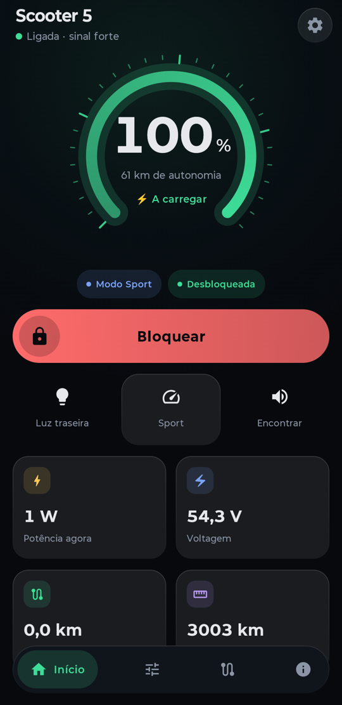
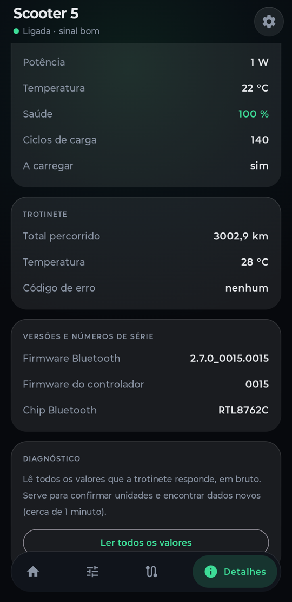

# Trotinete: app aberta para a Xiaomi Electric Scooter 5

App Android **não oficial** para controlar a Xiaomi Electric Scooter 5 sem a Mi Home. Inclui **bloqueio automático quando te afastas**, que a app da Xiaomi não tem.

<p align="center">
  
  &nbsp;&nbsp;
  
</p>

**[⬇️ Descarregar a APK (Releases)](../../releases/latest)** · Android 10 ou mais recente

> 🇬🇧 *Unofficial, open-source Android app for the Xiaomi Electric Scooter 5: dashboard, lock/unlock, proximity auto-lock (never while riding), trip recording and battery health, all without Mi Home. The UI is in Portuguese. See [English summary](#english-summary).*

---

## O que faz

| | |
|---|---|
| 🔋 **Painel** | Bateria, autonomia, potência em tempo real, voltagem, km da viagem e total |
| 🔒 **Bloquear / desbloquear** | Com um toque |
| 📡 **Bloqueio por afastamento** | Bloqueia sozinha quando o telemóvel se afasta e desbloqueia quando voltas (só se foi a app a bloquear) |
| 🛡️ **Segurança** | **Nunca bloqueia em andamento**: antes de bloquear, volta a confirmar na trotinete que está parada e que gasta pouca energia |
| 💡 **Luz traseira, modos, Encontrar** | Luz sempre acesa, Walk/Drive/Sport, apito para a encontrar |
| ⚙️ **Condução** | Travagem regenerativa, cruise control, controlo de tração e outras opções que a trotinete aceita |
| 🗺️ **Viagens** | Gravação automática com GPS: percurso, km, energia gasta e custo em € |
| 🔔 **Avisos de bateria** | Por exemplo "chegou aos 90%": parar a carga nos 80–90% faz a bateria durar mais anos |
| 🩺 **Saúde da bateria** | Ciclos, saúde e temperaturas, mais um histórico ao longo do tempo |

### O que **não** faz (de propósito)

- **Não mexe nos limites de velocidade.** O limite de 25 km/h é legal e de segurança. Essas propriedades estão bloqueadas no código.
- **Não liga a luz da frente.** A Scooter 5 só a liga no botão físico, não aceita esse comando por Bluetooth.
- **Não instala firmware.** O firmware da Xiaomi é assinado. A app não lhe toca.

---

## Antes de instalar

1. **A trotinete tem de estar associada na Mi Home** (a tua conta Xiaomi). A chave Bluetooth da trotinete é criada pela Xiaomi nessa associação e não há outra forma de a obter.
2. **Não removas a trotinete da Mi Home.** Se a voltares a associar, a chave muda e tens de repetir a configuração na app.
3. Basta a app ir buscar a chave **uma vez**. Depois funciona sem internet e sem a Mi Home.

## Instalar

1. Descarrega `trotinete-x.y.z.apk` em [Releases](../../releases/latest).
2. Abre o ficheiro no telemóvel. O Android pede para permitir a instalação de "fontes desconhecidas": aceita só para este ficheiro.
3. Abre a app:
   - **Lê o QR** do autocolante da trotinete (ou cola o link `home.mi.com/...`).
   - **Entra com a conta Xiaomi**. O login é feito na página oficial da Xiaomi e serve só para ir buscar a chave. Se a trotinete tiver PIN, a app pede-o.
4. Pronto: a app liga-se sozinha à trotinete sempre que está por perto.

> **Bloqueio automático:** para funcionar com o ecrã desligado, aceita o pedido para a app **não ser otimizada pela bateria**. Senão o Android pode pará-la em segundo plano.

## Afinar o bloqueio por afastamento

Em **Controlo → Segurança**:

- **Limiar (dBm):** quanto mais à esquerda, mais longe tens de ir para ela bloquear. Por omissão está em **−78 dBm**, afinado numa casa real: ao lado da trotinete o sinal anda entre −62 e −75, e a 15–20 m desce para −83 a −89.
- **Segundos:** quanto tempo de sinal fraco antes de bloquear. Uma queda brusca de sinal (por exemplo ao fechar a porta) bloqueia logo.
- **Desbloquear quando volto:** desbloqueia com sinal acima de limiar + 10 dBm durante 2 s, e só se foi a app que bloqueou. Um bloqueio teu à mão nunca é desfeito pela app.

O ecrã mostra o **sinal atual**. Afasta-te devagar e vê os números para escolher o teu limiar.

⚠️ O sinal Bluetooth varia com paredes, bolsos e o corpo. Isto é uma comodidade e **não substitui um cadeado**.

## Privacidade

- A chave da trotinete fica **cifrada com o Android Keystore** no teu telemóvel.
- A internet só é usada no login da Xiaomi, para ir buscar a chave. Não há telemetria, anúncios nem servidores nossos.
- As viagens (GPS) ficam só no telemóvel.

## Modelos testados

| Modelo | Estado |
|---|---|
| Xiaomi Electric Scooter 5 (`xiaomi.scooter.0005`, BLE 2.7.0_0015) | ✅ Testado na trotinete real |
| Scooter 5 Pro / 5 Max | ❓ Mesmo protocolo, não testado. Diz como correu num *issue*. |
| Modelos antigos (Pro 2, 3, 4…) | ❌ Usam outro protocolo |

Por confirmar numa volta real: cruise control, ASR, descida assistida e travão em rampa estão na app, mas ainda não foram verificados com a trotinete a andar.

---

## Para programadores

```
android/   App Android (Kotlin + Jetpack Compose)
  protocolo/   Bluetooth MIOT da Xiaomi: login ECDH + AES-CCM, get/set de propriedades
  servico/     Serviço em primeiro plano: ligação, bloqueio automático, gravação de viagens
  dados/       Conta Xiaomi (chave), definições, diário da bateria
  ui/          Ecrãs em Compose
pc/        Ferramentas em Python (bleak) para estudar a trotinete a partir do PC
```

**Compilar a app:**

```bash
cd android
./gradlew assembleDebug        # app/build/outputs/apk/debug/app-debug.apk
```

A versão de depuração aceita comandos por adb, que facilitam o estudo do protocolo:

```bash
adb shell am broadcast -n dev.josefelipe.trotinete/.servico.Depuracao --es cmd "get 2 4"
adb logcat Trotinete:* '*:S'
```

**Ferramentas do PC** (Linux/macOS/Windows com Bluetooth, [uv](https://docs.astral.sh/uv/)):

```bash
cd pc
uv run chave.py            # vai buscar a chave à conta Xiaomi (QR na Mi Home)
uv run ler.py AA:BB:CC:DD:EE:FF
```

A chave fica em `pc/secrets/`, que o git ignora.

## Créditos

- Protocolo Bluetooth da Scooter 5 Pro documentado por [KuziaMother/SCOOTER_5_PRO](https://github.com/KuziaMother/SCOOTER_5_PRO) e [desperado0044/xiaomi-scooter-5pro-ble](https://github.com/desperado0044/xiaomi-scooter-5pro-ble). Este projeto é uma implementação própria, a partir da documentação deles.
- Login na conta Xiaomi baseado no [Xiaomi-cloud-tokens-extractor](https://github.com/PiotrMachowski/Xiaomi-cloud-tokens-extractor) de Piotr Machowski (MIT).

## Aviso

Projeto pessoal, **sem qualquer ligação à Xiaomi**. "Xiaomi" e "Mi Home" são marcas dos respetivos donos. Usa por tua conta e risco: o autor não se responsabiliza por danos, multas ou trotinetes bloqueadas no sítio errado. Cumpre as regras de trânsito do teu país.

## Licença

[MIT](LICENSE)

---

## English summary

Unofficial Android app (UI in Portuguese) for the **Xiaomi Electric Scooter 5**, talking to it directly over Bluetooth:

- Live dashboard, lock/unlock, tail light, modes, find, riding settings.
- **Proximity auto-lock**: locks when your phone walks away (RSSI-based) and unlocks when you return. It **never locks while riding**: it re-checks "in motion" and power draw on the scooter itself before locking.
- GPS trip recording, battery alerts, battery health history.
- **Does not** change speed limits (by design), and does not touch firmware.

You need the scooter paired in Mi Home once. The app fetches the scooter's Bluetooth key from your Xiaomi account (official login page), stores it encrypted with Android Keystore, and then works offline. Tested on the Scooter 5 only. The 5 Pro and 5 Max likely work but are untested. Reports are welcome.
